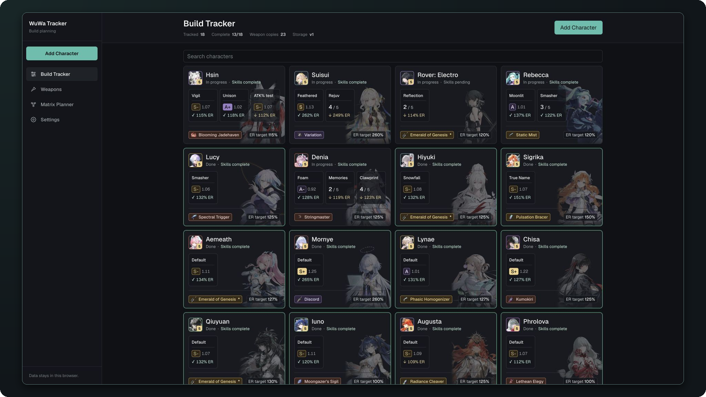

# WuWa Tracker

A personal build tracker for Wuthering Waves. Keep track of the echoes you're still farming, the ER you're missing, and which characters are sharing a weapon.



## What it tracks

- Up to three named echo builds per character, each with its own progress and ER.
- A quick echo checklist or detailed crit rolls and substats, with scores and farming estimates.
- Assigned weapons, owned copies, and shared weapons.
- Skills / Forte completion, build notes, and Matrix teams.

## Your data

Progress is saved in your browser's local storage. No account required.

Export a JSON backup from **Settings** to keep a copy or move to another browser. Importing a backup replaces the current tracker data.

## Running it

```bash
pnpm install
pnpm dev
```

Then open [localhost:3000](http://localhost:3000).

## Credits

Character and weapon names and artwork come from [Encore](https://encore.moe). The app needs network access to load the catalog. Substat priorities are curated from [Prydwen](https://www.prydwen.gg/wuthering-waves/).

This is an unofficial fan project. Wuthering Waves and its assets belong to Kuro Games.
